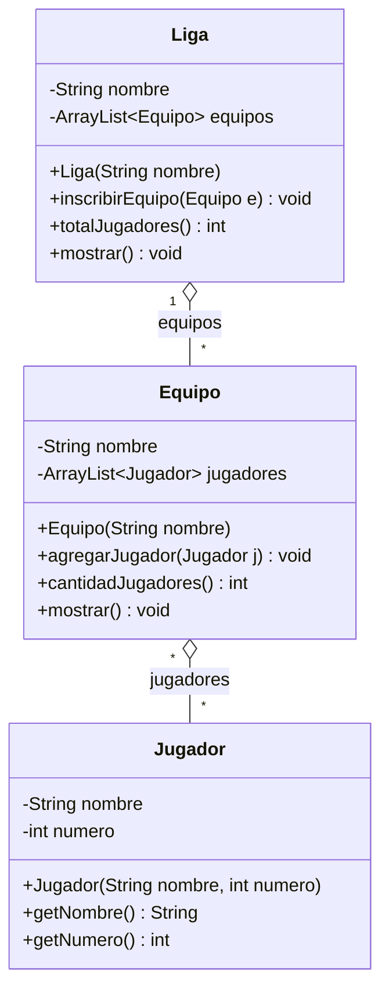
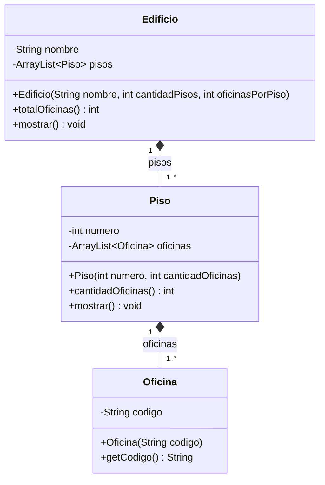
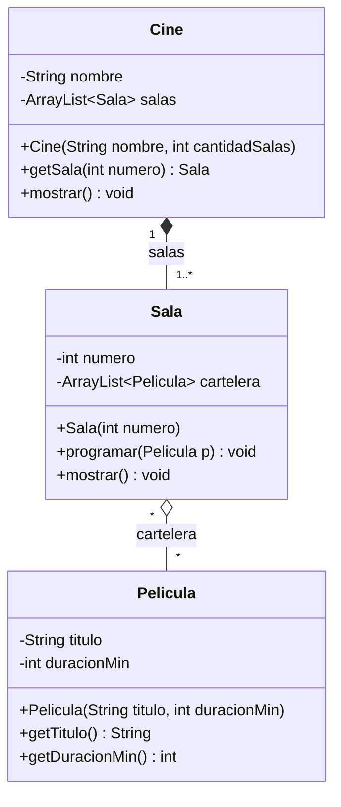
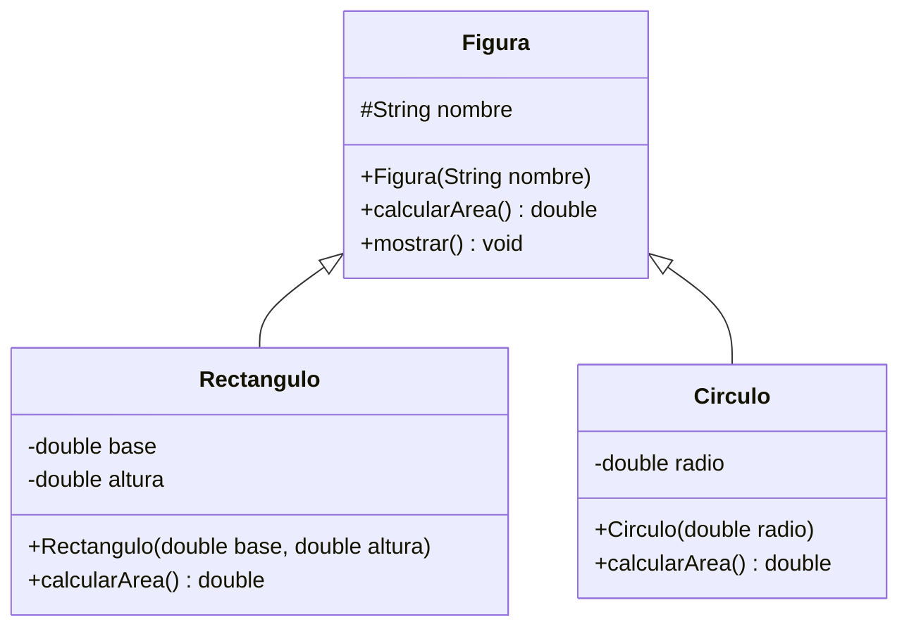
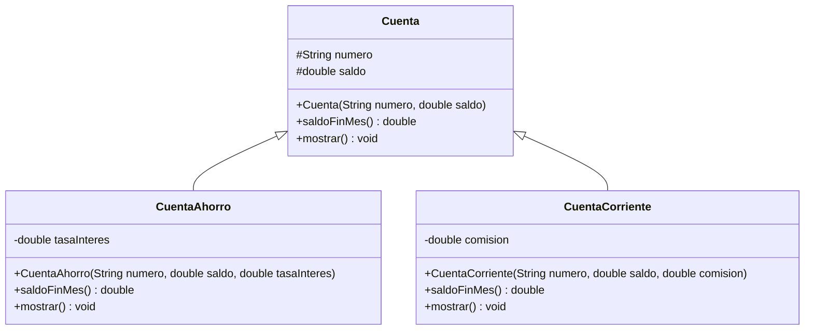
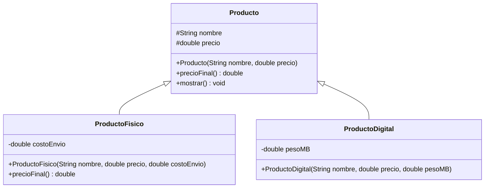

# Prácticas de clase · Semana 10

Seis prácticas para hacer en clase: **tres de relaciones anidadas** (Sesión A) y **tres de generalización** (Sesión B).
Cada una tiene un caso, su diagrama UML, los pasos a seguir y la salida que debes obtener.

**Cómo trabajar cada práctica**

1. Lee el caso y mira el diagrama UML: es el **diseño completo** de lo que debes programar (`-` atributo privado, `#` atributo protegido, `+` constructor o método público).
2. Crea un proyecto (o una carpeta) nuevo en tu IDE.
3. Sigue los pasos en orden: primero la clase del nivel más bajo, luego la que la contiene, al final el `Main`.
4. Comprueba que tu código tenga **todo lo que muestra el diagrama**: mismos atributos, constructores y métodos.
5. Compara tu salida con la **salida esperada**.
6. Responde la pregunta final con tus palabras.

---

# Parte 1 · Agregación y composición anidadas (Sesión A)

> **La pregunta de siempre, ahora en dos niveles:** ¿dónde está el `new` de cada parte? En agregación, en el `Main`. En composición, dentro del todo. Cuando hay tres clases encadenadas, tienes que responderla **dos veces**.

## Práctica 1 · Liga – Equipo – Jugador (agregación anidada)

**Caso:** una liga tiene varios equipos y cada equipo tiene varios jugadores. Un jugador puede ser transferido y sigue existiendo aunque su equipo desaparezca.



**Pasos**

1. Crea `Jugador` con `nombre` y `numero`, su constructor y sus getters.
2. Crea `Equipo` con `nombre` y `private ArrayList<Jugador> jugadores = new ArrayList<>();` (no olvides el `import java.util.ArrayList;`).
3. Escribe `agregarJugador(Jugador j)`: **recibe** el jugador ya creado.
4. Escribe `cantidadJugadores()` devolviendo `jugadores.size()` y `mostrar()` con el nombre y la lista.
5. Crea `Liga` con `nombre` y una lista de equipos, e `inscribirEquipo(Equipo e)`.
6. Escribe `totalJugadores()`: recorre los equipos y **suma lo que devuelve `cantidadJugadores()` de cada uno**. Aquí es donde se ve la anidación.
7. En `Main`: crea 3 jugadores, repártelos en 2 equipos, inscribe los equipos en la liga y llama a `mostrar()`.

**Salida esperada**

```
Liga Peruana (2 equipos)
  Equipo Alianza (2 jugador(es))
    - Lucía Paredes (#10)
    - Marco Ruiz (#7)
  Equipo Cristal (1 jugador(es))
    - Nadia Flores (#5)
Total de jugadores en la liga: 3
```

**Piensa:** `totalJugadores()` está en `Liga`, pero `Liga` no conoce a ningún `Jugador`. ¿Cómo consigue el número?

---

## Práctica 2 · Edificio – Piso – Oficina (composición anidada)

**Caso:** un edificio se construye con varios pisos y cada piso con varias oficinas. Ni los pisos ni las oficinas existen fuera de su edificio. Es el `Edificio` de la Semana 09, ahora con un nivel más.



**Pasos**

1. Crea `Oficina` con `codigo` (`String`), su constructor y su getter.
2. Crea `Piso` con `numero` y una lista de oficinas.
3. El constructor `Piso(int numero, int cantidadOficinas)` usa un `for` de `1` a `cantidadOficinas` y hace **`oficinas.add(new Oficina(numero + "-0" + i));`**.
4. Crea `Edificio` con `nombre` y una lista de pisos.
5. El constructor `Edificio(String nombre, int cantidadPisos, int oficinasPorPiso)` usa otro `for` y hace **`pisos.add(new Piso(i, oficinasPorPiso));`**.
6. Escribe `totalOficinas()` sumando `cantidadOficinas()` de cada piso.
7. En `Main`: una sola línea crea todo — `new Edificio("Torre USIL", 2, 3);` — y luego `mostrar()`. **No escribas `new Piso` ni `new Oficina` en el `Main`.**

**Salida esperada**

```
Edificio Torre USIL (2 pisos)
  Piso 1 (3 oficina(s))
    - 1-01
    - 1-02
    - 1-03
  Piso 2 (3 oficina(s))
    - 2-01
    - 2-02
    - 2-03
Total de oficinas: 6
```

**Piensa:** el `Main` de esta práctica tiene un solo `new` y el de la Práctica 1 tiene seis. ¿Por qué?

---

## Práctica 3 · Cine – Sala – Pelicula (las dos relaciones juntas)

**Caso:** un cine se construye con sus salas (una sala no existe fuera del cine), pero las películas se distribuyen a varios cines y existen por su cuenta.



**Pasos**

1. Crea `Pelicula` con `titulo` y `duracionMin`, su constructor y sus getters.
2. Crea `Sala` con `numero` y una lista `cartelera`. `programar(Pelicula p)` **recibe** la película (agregación).
3. Crea `Cine` con `nombre` y una lista de salas. Su constructor recibe `cantidadSalas` y hace el `new Sala(i)` en un `for` (composición).
4. Escribe `getSala(int numero)`: recorre las salas y devuelve la que tenga ese número (o `null` si no existe).
5. En `Main`: crea 2 películas, crea el cine con 2 salas y programa la misma película en las dos salas.
6. Muestra el cine y comprueba que el título aparece dos veces.

**Salida esperada**

```
Cine USIL Plaza (2 salas)
  Sala 1 (2 película(s))
    - Duna (155 min)
    - Intensamente 2 (96 min)
  Sala 2 (1 película(s))
    - Duna (155 min)
```

**Piensa:** en este diagrama hay un rombo relleno y uno vacío. ¿Qué pasaría si el cine cierra: con las salas y con las películas?

---

# Parte 2 · Generalización (Sesión B)

> En la generalización una clase **hereda** de otra: `class Subclase extends Superclase`. La subclase recibe gratis los atributos `protected` y los métodos de la superclase, llama a su constructor con `super(...)` y redefine con `@Override` **solo lo que cambia**.

## Práctica 4 · Figura – Rectangulo – Circulo

**Caso:** queremos calcular el área de figuras distintas con el mismo método.



**Pasos**

1. Crea `Figura` con el atributo **`protected String nombre`**, su constructor, `calcularArea()` devolviendo `0` y `mostrar()` que imprima `"<nombre>: área = <calcularArea()>"`.
2. Crea `Rectangulo extends Figura` con `base` y `altura`. Su constructor llama **`super("Rectángulo");`** como primera línea y luego guarda sus dos atributos.
3. Sobrescribe `calcularArea()` con `@Override`: `base * altura`.
4. Crea `Circulo extends Figura` con `radio`, constructor con `super("Círculo");` y `calcularArea()` devolviendo `Math.PI * radio * radio`.
5. Ninguna de las dos subclases escribe `mostrar()`: **lo heredan tal cual**.
6. En `Main`: crea un rectángulo de 4 x 5 y un círculo de radio 3, y llama a `mostrar()` en cada uno.

**Salida esperada**

```
Rectángulo: área = 20.0
Círculo: área = 28.274333882308138
```

**Piensa:** `mostrar()` está escrito una sola vez, en `Figura`, y llama a `calcularArea()`. ¿Cómo sabe cuál de las dos fórmulas usar?

---

## Práctica 5 · Cuenta – CuentaAhorro – CuentaCorriente

**Caso:** un banco maneja dos tipos de cuenta. Las dos tienen número y saldo, pero el saldo final de fin de mes se calcula distinto: la cuenta de ahorro gana 2 % de interés y la corriente paga una comisión fija de S/ 15.



**Pasos**

1. Crea `Cuenta` con `protected numero` y `protected saldo`, su constructor, `saldoFinMes()` devolviendo `saldo` y `mostrar()` imprimiendo `"Cuenta <numero> | saldo: S/ <saldo>"`.
2. Crea `CuentaAhorro extends Cuenta` con `tasaInteres`. Constructor con `super(numero, saldo);`.
3. Sobrescribe `saldoFinMes()`: `saldo + saldo * tasaInteres`.
4. Sobrescribe `mostrar()`: llama a **`super.mostrar();`** y agrega `"  Ahorro - saldo a fin de mes: S/ ..."`.
5. Crea `CuentaCorriente extends Cuenta` con `comision`. Su `saldoFinMes()` devuelve `saldo - comision` y su `mostrar()` también usa `super.mostrar()`.
6. En `Main`: crea una cuenta de ahorro con S/ 1000 al 0.02 y una corriente con S/ 1000 y comisión 15, y muestra ambas.

**Salida esperada**

```
Cuenta A-001 | saldo: S/ 1000.0
  Ahorro - saldo a fin de mes: S/ 1020.0
Cuenta C-001 | saldo: S/ 1000.0
  Corriente - saldo a fin de mes: S/ 985.0
```

**Piensa:** `super.mostrar()` y `super(...)` se escriben parecido pero hacen cosas distintas. ¿Cuál es la diferencia?

---

## Práctica 6 · Una sola lista para varios tipos (polimorfismo)

**Caso:** una tienda vende productos físicos y digitales. Al físico se le suma S/ 10 de envío; el digital no tiene envío. Queremos cobrar toda la boleta recorriendo **una sola lista**.



**Pasos**

1. Crea `Producto` con `protected nombre` y `protected precio`, `precioFinal()` devolviendo `precio` y `mostrar()` imprimiendo `"<nombre>: S/ <precioFinal()>"`.
2. Crea `ProductoFisico extends Producto` con `costoEnvio` y sobrescribe `precioFinal()`: `precio + costoEnvio`.
3. Crea `ProductoDigital extends Producto` con `pesoMB`. **No sobrescribe nada**: hereda el `precioFinal()` de `Producto`.
4. En `Main`, declara `ArrayList<Producto> boleta = new ArrayList<>();` y agrégale un producto físico y uno digital.
5. Recorre la lista con un `for (Producto p : boleta)`, llama a `p.mostrar()` y acumula `p.precioFinal()` en una variable `total`.
6. Muestra el total.

**Salida esperada**

```
Teclado mecánico: S/ 260.0
Curso de Java: S/ 120.0
Total de la boleta: S/ 380.0
```

**Piensa:** la lista está declarada como `ArrayList<Producto>`, no como `ArrayList<ProductoFisico>`. ¿Por qué eso es lo que permite mezclar los dos tipos?

---

## Para cerrar

Completa esta tabla con tus palabras:

| Relación | ¿Quién hace el `new` de la parte? | ¿Qué pasa con la parte si desaparece el todo? |
|---|---|---|
| Agregación | | |
| Composición | | |

Y esta otra:

| Palabra clave | ¿Para qué sirve? | ¿Dónde se escribe? |
|---|---|---|
| `extends` | | |
| `protected` | | |
| `super(...)` | | |
| `super.metodo()` | | |
| `@Override` | | |
