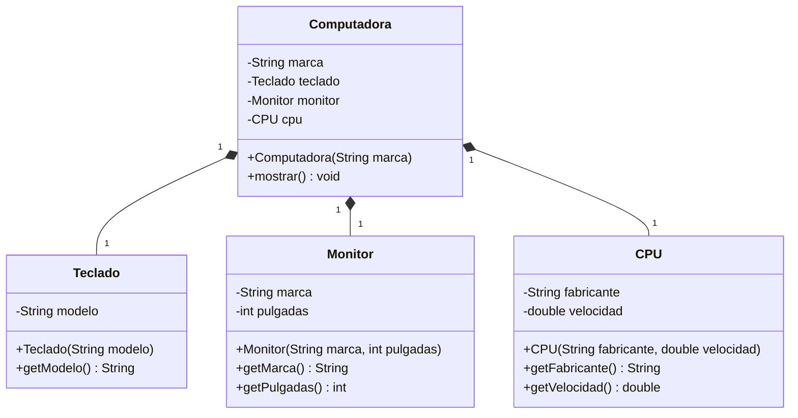
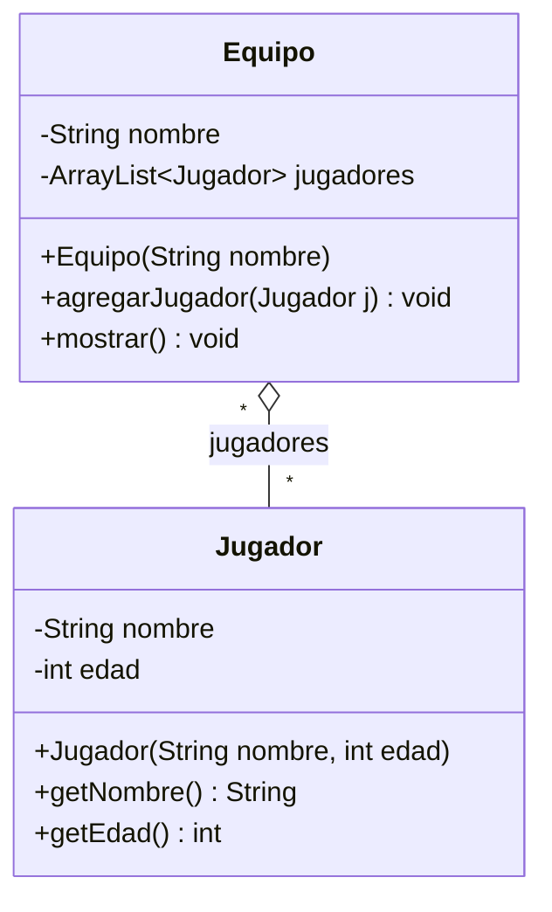
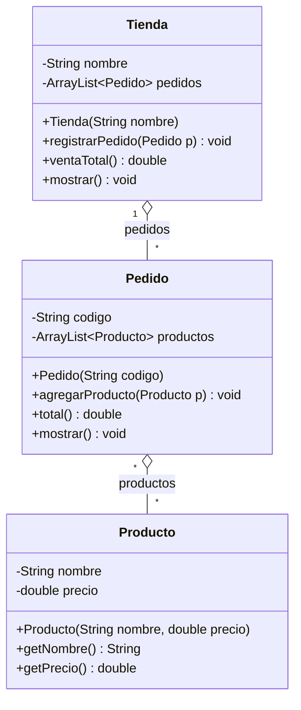
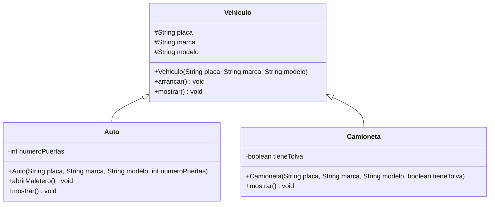
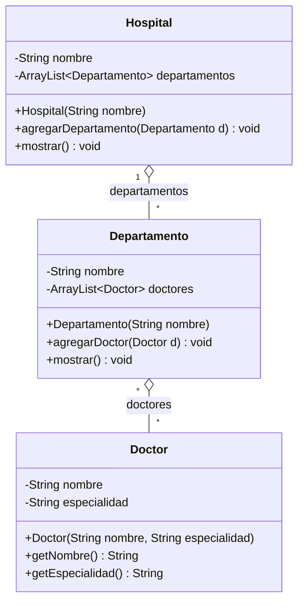
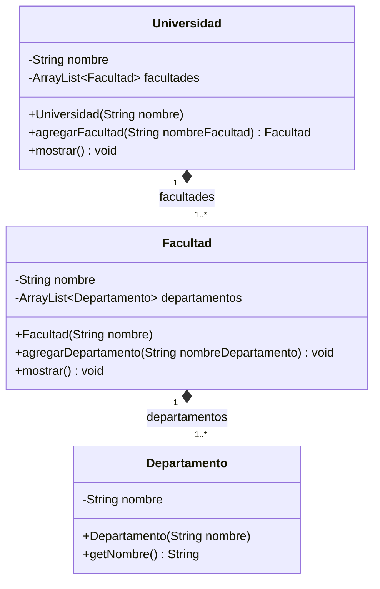
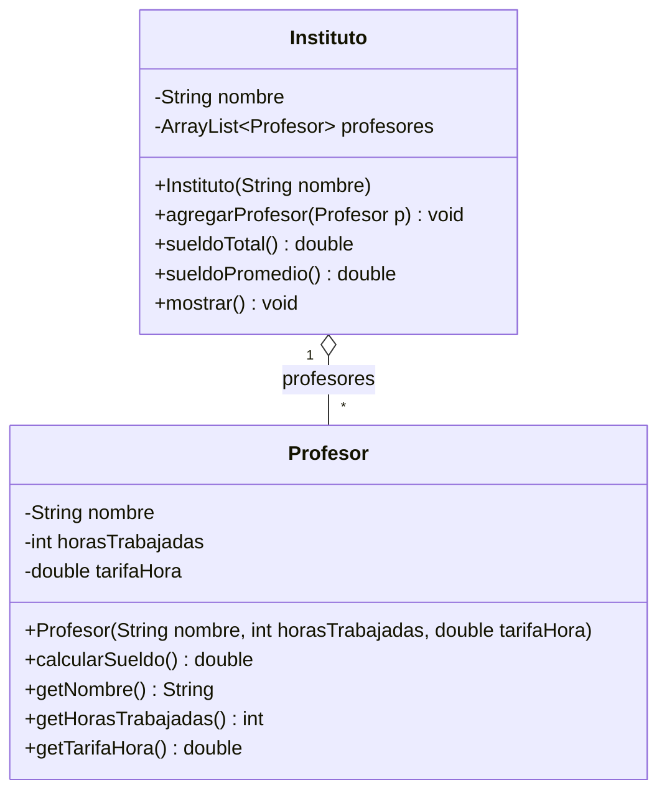
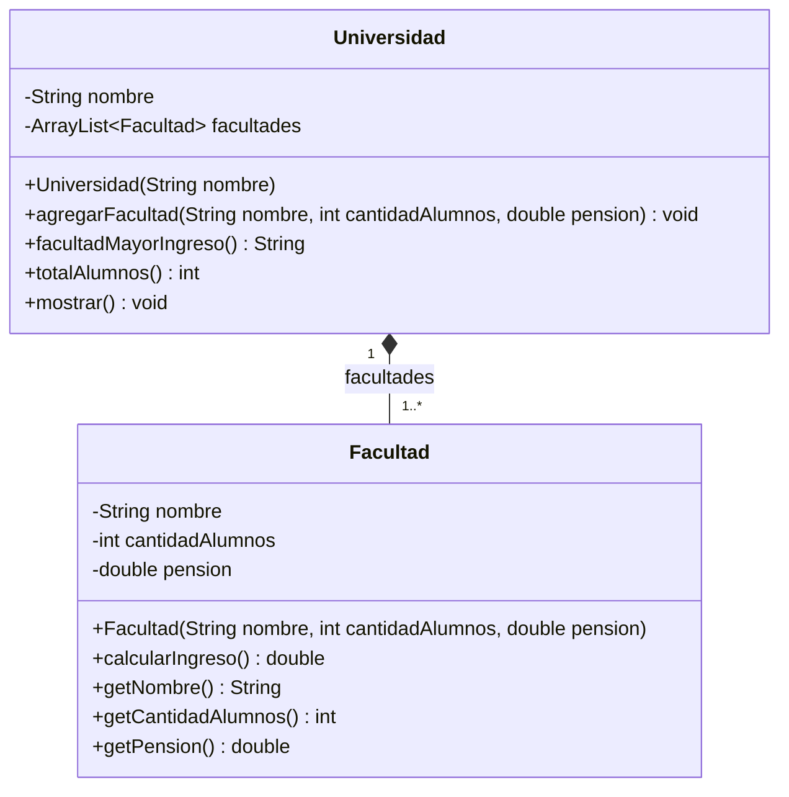
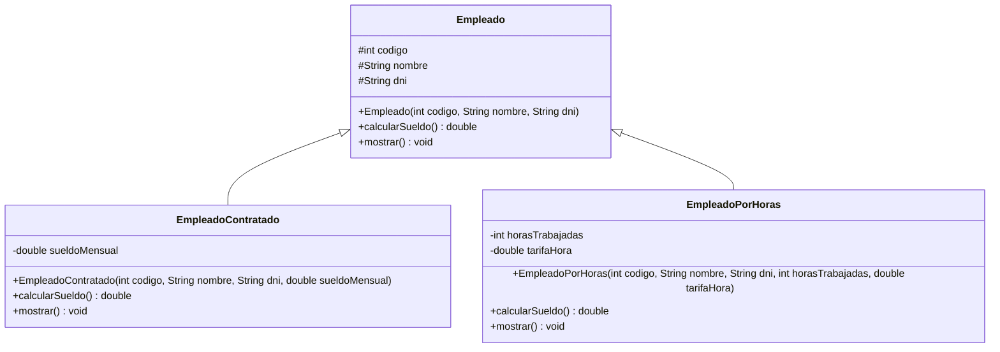
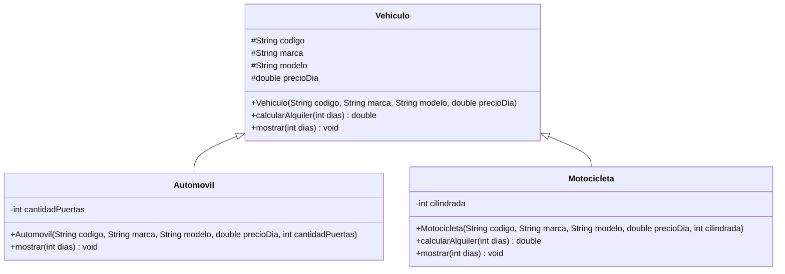

# USIL – Programación Orientada a Objetos I · Semana 10

## Relaciones anidadas y generalización: del diagrama UML al código Java

Código que acompaña la sesión de **agregación y composición anidadas** y de **generalización (herencia)**.
Cada carpeta es un proyecto independiente con su propio `Main.java`.

👉 **Prácticas de clase paso a paso:** [`PRACTICAS_CLASE.md`](PRACTICAS_CLASE.md)

### Qué se trabaja en cada sesión

| Sesión | Tema | Carpetas |
|---|---|---|
| **A (3 h)** | Agregación y composición **anidadas** (listas dentro de listas) | `EjemploResuelto01`–`EjemploResuelto03`, `Actividad01`–`Actividad04` |
| **B (2 h)** | **Generalización**: `extends`, `super`, `@Override`, polimorfismo | `EjemploResuelto04`, `EjemploResuelto05`, `Actividad05`, `Actividad06` |

> En la Semana 09 viste la agregación y la composición entre **dos** clases. Esta semana la relación es la misma, pero encadenada: `Hospital → Departamento → Doctor`. Lo realmente nuevo es la **generalización**.

## Del diagrama al código (resumen)

| En el diagrama UML | En Java |
|---|---|
| Multiplicidad `1` | un atributo: `private Motor motor;` |
| Multiplicidad `*` o `1..*` | una lista: `private ArrayList<Doctor> doctores;` |
| Agregación `◇` | la parte **llega por parámetro** (se crea afuera, en el `Main`) |
| Composición `◆` | el todo **hace el `new`** de la parte (el `Main` nunca la crea) |
| Agregación/composición **anidada** | la parte es a su vez un todo: una lista dentro de otra lista |
| Generalización `◁—` | `class Subclase extends Superclase` |
| Atributo heredado | `protected` en la superclase |
| Constructor de la superclase | `super(...)` como **primera línea** del constructor de la subclase |
| Método redefinido | `@Override` sobre el método en la subclase |

**Cómo leer los diagramas:** `-` es atributo privado, `#` es atributo protegido, `+` es constructor o método público. Cada diagrama muestra **todas** las clases con los mismos atributos, constructores y métodos que tiene el código de su carpeta.

---

# Sesión A · Agregación y composición anidadas

## EjemploResuelto01 · Composición: `Computadora` – `Teclado` / `Monitor` / `CPU`

Las partes son **tres clases distintas**, no una lista. La `Computadora` hace el `new` de cada una dentro de su constructor: desde el `Main` no se crea ningún `Teclado`, `Monitor` ni `CPU`.

> **Ojo con la diapositiva.** En el material de clase la `Computadora` recibe el teclado, el monitor y la CPU **por parámetro**, con los `new` en el `Main`. Ese código es, en la práctica, una agregación. Aquí se respeta la definición de la propia diapositiva ("el contenedor es responsable de la creación de las partes") y la regla que usamos en la Semana 09: **en composición el `new` va dentro del todo**.

📁 [`EjemploResuelto01`](EjemploResuelto01)

## EjemploResuelto02 · Agregación: `Equipo` – `Jugador`

Repaso corto. El mismo `Jugador` está en dos equipos a la vez y sobrevive a la desaparición de uno.

📁 [`EjemploResuelto02`](EjemploResuelto02)

## EjemploResuelto03 · Agregación anidada en 3 niveles: `Tienda` – `Pedido` – `Producto`

El nivel del medio (`Pedido`) es **parte** de la tienda y a la vez **todo** de sus productos. Fíjate en cómo `Tienda.ventaTotal()` llama a `Pedido.total()`, que a su vez recorre sus productos: un bucle dentro de otro bucle, repartido entre dos clases.

📁 [`EjemploResuelto03`](EjemploResuelto03)

---

# Sesión B · Generalización

## EjemploResuelto04 · Generalización: `Empleado` – `EmpleadoContratado` – `EmpleadoPorHoras`

Los tres datos comunes (`codigo`, `nombre`, `dni`) se escriben **una sola vez** en la superclase. Cada subclase redefine `calcularSueldo()` con su propia fórmula y amplía `mostrar()` reutilizando `super.mostrar()`.

📁 [`EjemploResuelto04`](EjemploResuelto04)

## EjemploResuelto05 · Polimorfismo: `Vehiculo` – `Auto` – `Camioneta`

Un solo arreglo `Vehiculo[]` guarda objetos de los tres tipos. Al llamar `v.mostrar()`, Java elige el método de la clase **real** del objeto, no el del tipo declarado. Eso es polimorfismo.

📁 [`EjemploResuelto05`](EjemploResuelto05)

---

## Actividades de la semana

Son las **tres actividades de aprendizaje de la Semana 10** (documento `(10-2) Actividad-1`), una carpeta por caso.

| Carpeta | Actividad | Caso | Qué debes hacer |
|---|---|---|---|
| [`Actividad01`](Actividad01) | 1 · Agregación | `Hospital` – `Departamento` – `Doctor` | Completar los 6 `TODO` de `Departamento` y `Hospital` |
| [`Actividad02`](Actividad02) | 1 · Composición | `Universidad` – `Facultad` – `Departamento` | Completar los 3 `TODO`: el `new` va **dentro** del todo |
| [`Actividad03`](Actividad03) | 2 · Agregación | `Instituto` – `Profesor` | Sueldo total y promedio, con datos por consola |
| [`Actividad04`](Actividad04) | 2 · Composición | `Universidad` – `Facultad` | Ingreso por facultad, mayor ingreso y total de alumnos |
| [`Actividad05`](Actividad05) | 3 · Generalización | `Empleado` y sus dos subclases | Escribir los `super(...)` y los `@Override` |
| [`Actividad06`](Actividad06) | 3 · Generalización | `Vehiculo` – `Automovil` – `Motocicleta` | Recargo del 10 % en moto y comparación por tipo |

> Los ejercicios **no compilan tal cual**: faltan los `TODO`. Es lo esperado.

### Actividad01 · `Hospital` – `Departamento` – `Doctor` (agregación)

Un doctor puede trabajar en varios departamentos y en varios hospitales, así que **existe por su cuenta**: los `new Doctor` están en el `Main`.

### Actividad02 · `Universidad` – `Facultad` – `Departamento` (composición)

El caso espejo del anterior. Un departamento **solo existe dentro de su facultad**, y una facultad solo dentro de su universidad: el `Main` solo hace `new Universidad(...)`, nada más.

**Compara los dos diagramas de arriba.** Mismo dibujo, mismas multiplicidades, y solo cambia el rombo: `◇` vacío en el hospital, `◆` relleno en la universidad. Toda la diferencia está en **dónde se escribe el `new`**.

### Actividad03 · `Instituto` – `Profesor` (agregación · Actividad 2 del documento oficial)

### Actividad04 · `Universidad` – `Facultad` (composición · Actividad 2 del documento oficial)

> Fíjate en la firma de `agregarFacultad`: recibe **datos sueltos**, no una `Facultad`. Esa es la pista de que es composición.

### Actividad05 · `Empleado` y sus subclases (Actividad 3 del documento oficial)

### Actividad06 · `Vehiculo` – `Automovil` – `Motocicleta` (Actividad 3 del documento oficial)

El `Automovil` **no** redefine `calcularAlquiler`: hereda la fórmula tal cual. La `Motocicleta` sí, porque añade el 10 % de recargo. Redefinir solo lo que cambia es la idea central de la herencia.

